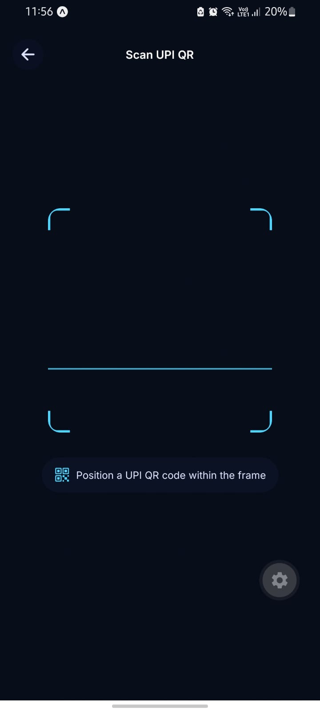
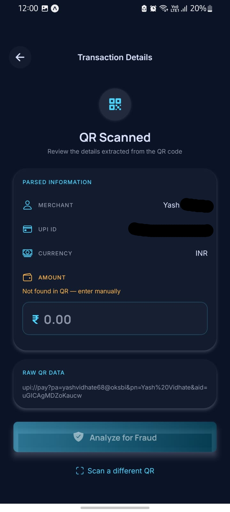
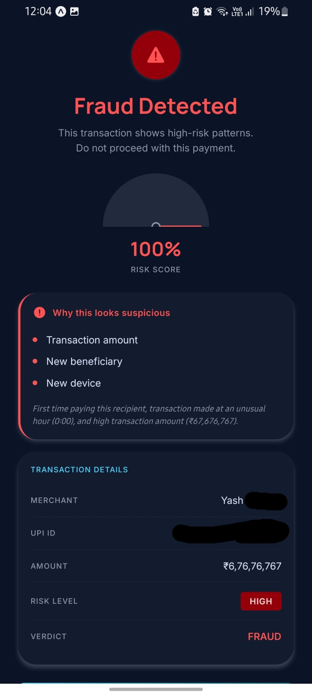
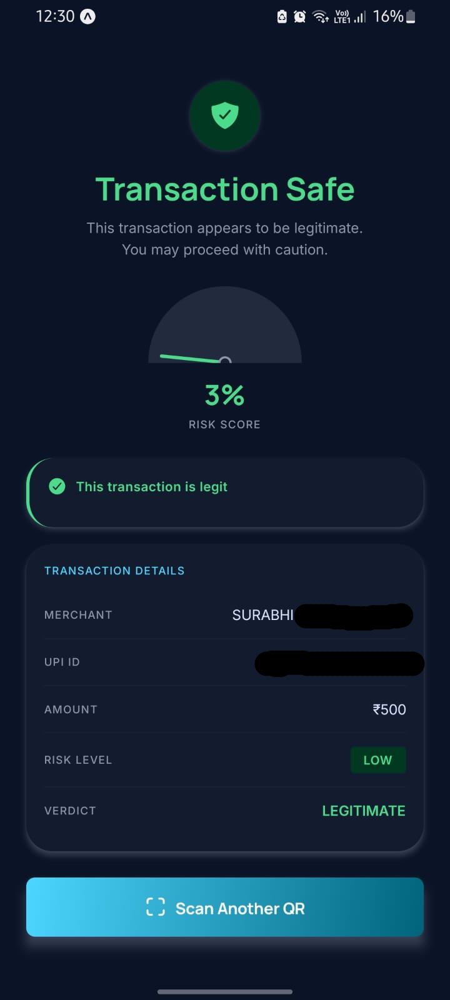
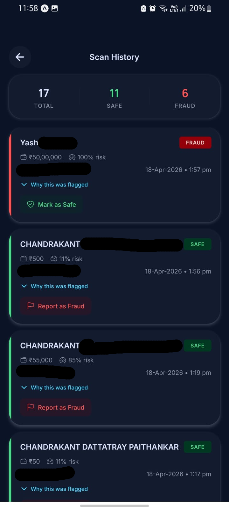

# Sentinel — Real-Time UPI Fraud Detection System

Sentinel is an end-to-end intelligent fraud prevention system designed for UPI (Unified Payments Interface) transactions. It combines a lightweight React Native mobile application for instant QR code scanning, a high-performance FastAPI inference backend, an Explainable AI (XAI) pipeline powered by XGBoost, and Firebase for secure user authentication and scan auditing.

---

## 🌟 Key Highlights

- **Real-Time Scanning & Inference:** Scan standard UPI QR codes (`upi://pay?...`), parse payload parameters on-device, and predict fraud risk within milliseconds.
- **High-Accuracy ML Pipeline:** Built on real-world Indian cybercrime and banking fraud taxonomy (RBI, NPCI, PwC guidelines), achieving **98.6% Accuracy** and **0.9876 ROC-AUC**.
- **Explainable AI (XAI):** Unpacks black-box decisions into human-readable explanations (e.g., *"Amount is 8x higher than your usual spending and transaction initiated from an unrecognized device"*).
- **Secure Authentication & Audit Trail:** Powered by Firebase Authentication and Cloud Firestore to maintain per-user historical scan logs with granular security rules.
- **Modern Sentinel Aesthetic UI:** Built with React Native & Expo using dark-mode tonal architecture and glassmorphism.

---

## 📱 Application Preview

| QR Scanner | Transaction Details | Suspicious Result (XAI) | Safe Result | History & Audit Log |
|:---:|:---:|:---:|:---:|:---:|
|  |  |  |  |  |

---

## 🏗 System Architecture & Workflow

```
[ UPI QR Code ] ──(Camera Scan)──► [ React Native (Expo) Mobile App ]
                                            │
                                            ▼ (HTTP POST /predict)
                                 [ FastAPI Backend Server ]
                                            │
                                            ▼
                    ┌──────────────────────────────────────────────┐
                    │            ML Preprocessing & XAI            │
                    │  1. Label Encoding Categoricals              │
                    │  2. Missing Value Imputation (Median)        │
                    │  3. Feature Scaling (StandardScaler)         │
                    │  4. Dimensionality Reduction (PCA 95%)       │
                    │  5. XGBoost Classifier (Probability + Risk)  │
                    │  6. PCA Feature Reverse-Mapping & XAI Logic  │
                    └──────────────────────────────────────────────┘
                                            │
                                            ▼
[ Result Screen: Safe / Warning / Fraud + Plain English Explanation ]
                                            │
                                            ▼
           [ Cloud Firestore: Per-User Scan History Audit Trail ]
```

---

## 🤖 Machine Learning & XAI Engine

### 1. Feature Representation (17 Input Signals)
- **Financial & Behavioral:** `amount`, `Amount_vs_User_Avg_Ratio`, `Transaction_Frequency_24h`, `Days_Since_Last_Txn`, `Failed_PIN_Attempts`.
- **Contextual & Security Flags:** `Is_New_Beneficiary`, `Is_New_Device`, `Is_First_Time_User`, `Is_QR_Transaction`, `Location_Mismatch`, `Is_Weekend`, `Hour`.
- **Categorical Parameters:** `UPI_App`, `Transaction_Type`, `Transaction_Status`, `Transaction_State`, `Device_OS`.

### 2. Model Performance
- **Algorithm:** XGBoost (`XGBClassifier`) with SMOTE class balancing and PCA.
- **ROC-AUC:** `0.9876` | **Accuracy:** `98.60%` | **Precision:** `93.80%` | **Recall:** `77.10%`
- **Optimal Decision Threshold:** `0.869` (optimized via Precision-Recall curve to minimize false positives).

### 3. Explainability (XAI)
Rather than presenting opaque numbers, Sentinel maps dominant PCA component weights back to original features, compares actual transaction signals against baseline rules, and generates human-understandable verdicts on the mobile client.

---

## 💻 Tech Stack

| Domain | Technologies |
|---|---|
| **Mobile Client** | React Native, Expo, React Navigation, React Native Paper, Axios |
| **Backend API** | Python 3, FastAPI, Uvicorn, Pydantic, Joblib, Pandas, NumPy |
| **Machine Learning** | Scikit-Learn, XGBoost, Imbalanced-Learn (SMOTE) |
| **Cloud & Database**| Firebase Auth, Cloud Firestore, Render.com |

---

## 📁 Repository Structure

```
UPI-Fraud-Detection/
├── backend/
│   ├── main.py                  # FastAPI server, ML inference & XAI explanation engine
│   └── requirements.txt         # Backend Python dependencies
├── model/
│   ├── UPI_Fraud_Detection.ipynb# Complete data pipeline, training & evaluation notebook
│   ├── xgboost_model.pkl        # Trained XGBoost model artifact
│   ├── scaler.pkl               # StandardScaler object
│   ├── pca.pkl                  # Fitted PCA transformer
│   ├── imputer.pkl              # SimpleImputer object
│   ├── label_encoders.pkl       # Encoders for categorical features
│   ├── feature_cols.pkl         # Ordered list of training features
│   └── threshold.pkl            # Decision boundary threshold
├── mobile/
│   ├── src/
│   │   ├── config/              # Firebase configuration
│   │   ├── screens/             # Auth, Home, Scanner, Result, History screens
│   │   ├── services/            # API client and Firestore history service
│   │   └── theme.js             # Sentinel design tokens & colors
│   ├── App.js                   # Navigation container and Auth state observer
│   └── package.json             # Mobile app dependencies
├── render.yaml                  # Render deployment configuration
└── README.md                    # Project documentation
```

---

## 🚀 Quickstart Guide

### 1. Backend Setup

```bash
# Navigate to backend
cd backend

# Create & activate a virtual environment
python -m venv venv
venv\Scripts\activate   # On Windows (or source venv/bin/activate on Linux/macOS)

# Install dependencies
pip install -r requirements.txt

# Start local server
uvicorn main:app --reload --host 0.0.0.0 --port 8000
```
- API Docs will be live at: `http://localhost:8000/docs`
- Health check: `http://localhost:8000/health`

### 2. Mobile App Setup

```bash
# Navigate to mobile directory
cd mobile

# Install npm packages
npm install

# Start the Expo development server
npx expo start
```
- Scan the QR code using the **Expo Go** application on Android or run `a` for Android Emulator.
- Configure `mobile/src/api.js` to point to your backend local network IP or hosted Render URL.

---

## 🔒 Security & Privacy

- **Zero Payment Risk:** Sentinel acts strictly as an advisory intelligence layer before payment execution; no UPI PINs or banking credentials are intercepted or stored.
- **Data Protection:** Per-user Firestore security rules guarantee that scan histories are only readable/writable by the authenticated owner.
- **Anonymization:** Identifiers such as IP addresses, Device IDs, and customer names are stripped before feature extraction.
